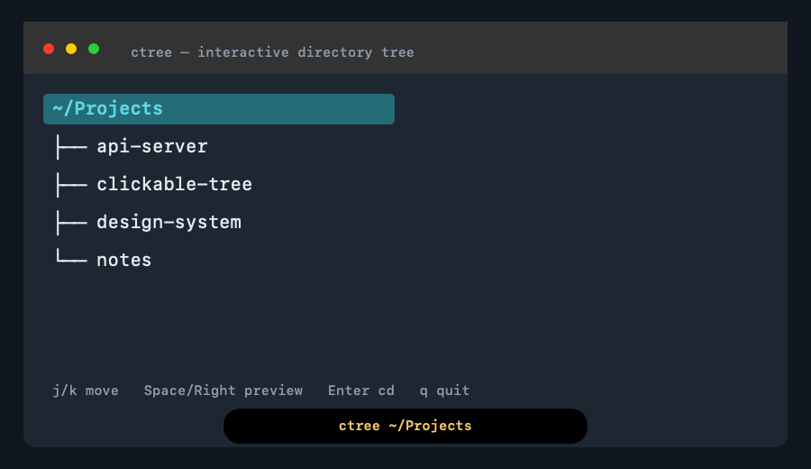

# ctree

`ctree` is a small, dependency-free C program that prints a directory tree and,
in an interactive terminal, lets you inspect and enter directories with a
keyboard or mouse. It builds on macOS and Linux with a C compiler and `make`.



See [how ctree works and its terminal requirements](docs/how-it-works.md) and
the [development guide](docs/development.md) for implementation details.

## Install

```sh
make
make test
make install PREFIX="$HOME/.local"
```

Put `$HOME/.local/bin` on `PATH`, then source the installed shell function in
your shell's startup file. This function is required because a child process
cannot change the working directory of its parent shell.

**Bash** (`~/.bashrc`):

```bash
source "$HOME/.local/share/ctree/ctree.bash"
```

**Zsh** (`~/.zshrc`):

```zsh
source "$HOME/.local/share/ctree/ctree.zsh"
```

**Fish** (`~/.config/fish/config.fish`):

```fish
source "$HOME/.local/share/ctree/ctree.fish"
```

Open a new shell, or source the startup file, then run `ctree`.

## Usage

```sh
ctree                     # current directory, interactive on a terminal
ctree -a -L 2 ~/Projects  # hidden files and a two-level limit
ctree -d --dirsfirst      # directories only
ctree --keyboard-only .   # interactive, with no mouse reporting
ctree --plain .            # static output in terminal scrollback
ctree -L 3 . > tree.txt   # static output when redirected
```

Use `j`/`k` or Up/Down to select a directory. Press Space or Right to see its
direct children in a floating box. Press Enter to change the shell directory.
Esc or Left closes the box; pressing Space or Right again also toggles it off.
Page Up/Down moves five rows, and `q`, Ctrl-C, or Ctrl-Z exits. The box does
not open files.

With a mouse, one click previews a directory and a second click on that same
directory within 450 ms changes the shell directory. The wheel moves five rows.

Supported tree-style options are `-a`, `-d`, `-L N`, `-I PATTERN`, `-P PATTERN`,
`-f`, `-p`, `-s`, `-h`, `-t`, `-r`, `-i`, `-F`, `-n`, `--dirsfirst`, and
`--noreport`. `--help` lists them. Options must precede directory arguments.
Multiple roots are accepted. Patterns use shell glob syntax, so quote them to
prevent your shell from expanding them.
